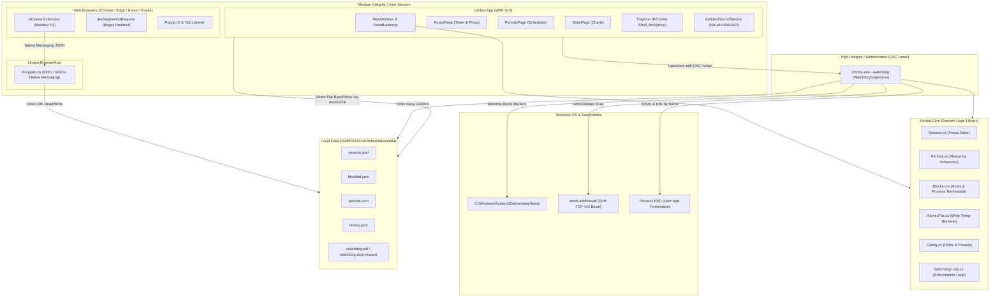

# GRITWALL — Comprehensive Upstream Source Code & Architecture Audit Report
## Mission 002: Architectural Blueprint & Codebase Analysis

**Repository:** `D:\Projects\Gritwall` (Upstream: `zixload/umbra`)  
**Active Branch:** `gritwall/source-audit`  
**Inspected Git Commit:** `5978b0d` (*Fix culture-dependent period tests*)  
**Test Suite Status:** 129 / 129 Tests Passing (0 Errors, 0 Warnings)  
**Target Platform:** Windows 11 (x64) — .NET 10.0.403, C# 14, WPF, WinUI  
**Author:** Senior Systems & Security Architect, GRITWALL Core Engineering  

---

## 1. Executive Summary

This audit establishes the definitive technical foundation for **GRITWALL**, a privacy-focused, local-first Windows 11 digital wellbeing, distraction-blocking, and productivity analytics platform built upon the open-source **Umbra** codebase.

### Core Verdict
Umbra provides an exceptional, modern WPF application foundation utilizing `Wpf.Ui` (WinUI 3 styling), fluent acrylic backdrop integration (`DwmBackdrop`), a low-latency procedural ambient sound engine (`NAudio.Wasapi`), and a robust recurring schedule manager (`Periods.cs`). The solution restores and compiles cleanly under .NET 10 SDK, with its full 129-test suite passing.

However, the upstream codebase was engineered strictly as an **active focus session and calendar period blocker**. It currently possesses:
1. **Zero passive screen time tracking:** No background window focus monitoring or per-application time accumulation exists.
2. **Zero passive website tracking:** The browser extension operates in binary redirect mode (`declarativeNetRequest`) without reporting browsing duration or domain history.
3. **Severe Hard Mode vulnerabilities:** The elevated watchdog can be terminated voluntarily by any unprivileged user via a signal file backdoor (`watchdog.stop-request`), configuration files can be tampered with in plaintext, and session countdowns can be bypassed by shifting the Windows system clock.

GRITWALL will **not** rebuild from scratch. We will retain the polished desktop UI, sound synthesis engine, and scheduling mechanisms, while integrating:
- A high-performance Win32 event hook (`SetWinEventHook`) and idle detector (`GetLastInputInfo`).
- An embedded SQLite persistence engine (`Microsoft.Data.Sqlite`) with Write-Ahead Logging (WAL), deterministic event-driven flushing (on application transitions, idle state changes, session locks, and graceful shutdown), and startup crash recovery.
- A **privacy-by-design website tracking schema** persisting only normalized hostnames and minimum duration metadata (strictly excluding URL paths, query strings, and page document titles by default).
- Granular per-application and per-website daily allowances.
- Tamper-resistant IPC (Windows Named Pipes with ACLs) and monotonic hardware timers (`Environment.TickCount64`).

---

## 2. Complete System Architecture Diagram



---

## 3. Repository Structure & Project Responsibilities

```
D:\Projects\Gritwall\
├── Umbra.slnx                     # Modern XML-based Visual Studio Solution descriptor
├── Umbra.App\                     # WPF UI, Navigation, Views, Tray, Win32 P/Invoke
│   ├── App.xaml / App.xaml.cs     # Startup, single instance coordinator, exception recovery
│   ├── MainWindow.xaml / .cs      # Fluent Shell, Navigation, Acrylic DwmBackdrop
│   ├── TrayIcon.cs                # Pure P/Invoke Win32 Shell_NotifyIcon implementation
│   ├── BrowserIntegration.cs      # Native messaging registry configuration (Chrome/Edge/Brave)
│   ├── WatchdogSupervisor.cs      # Elevated watchdog launcher via ShellExecuteEx 'runas'
│   ├── AmbientSoundService.cs     # Procedural white/pink/brown/binaural audio (NAudio)
│   ├── Pages\                     # MVVM Views: FocusPage, BlocklistPage, PeriodsPage, StatsPage
│   └── browser-extension\         # Manifest V3 extension for Chromium browsers
├── Umbra.Core\                    # Shared Domain Logic, Models, Enforcement Engines
│   ├── Blocker.cs                 # Hosts file writer, Firewall DoH modifier, Process.Kill
│   ├── WatchdogLoop.cs            # 2000ms polling loop, trusted period cache, signal checker
│   ├── Session.cs                 # Focus session state, Pomodoro phase machine, countdown
│   ├── Periods.cs                 # Calendar schedules, day-of-week & cross-midnight logic
│   ├── Blocklist.cs               # Blocklist models, presets (Social, Games, Default)
│   ├── AtomicFile.cs              # Atomic write-temp-rename persistence helper
│   ├── Config.cs                  # File paths, protected processes, DoH IP constants
│   ├── History.cs / StatsRange.cs # Focus session history persistence and chart aggregations
│   └── SingleInstanceCoordinator  # Mutex & named pipe single-instance locking
├── Umbra.BrowserHost\             # Standard I/O Native Messaging binary for Chromium
│   └── Program.cs                 # 32-bit length-prefixed JSON protocol reader/writer
├── Umbra.Tests\                   # Unit and Integration test suite (xUnit)
│   ├── PeriodsTests.cs            # Culture-invariant schedule verification (Fixed in 5978b0d)
│   ├── WatchdogLoopTests.cs       # Watchdog loop tick and phantom period tests
│   └── BlockerTests.cs            # Hosts file marker parsing and stripping tests
└── installer\                     # Deployment packaging
    └── Umbra.iss                  # Inno Setup 6 packaging script
```

### External Dependencies
Umbra maintains an exceptionally lean dependency profile:
- `Wpf.Ui` (v4.3.0) — Modern Windows 11 controls, NavigationView, system theme sync.
- `Microsoft.Toolkit.Uwp.Notifications` (v7.1.3) — Native Windows 11 Action Center toast notifications.
- `NAudio.Wasapi` (v2.2.1) — Windows Audio Session API for procedural sound synthesis.

---

## 4. Application-Blocking Analysis

- **Identification Mechanism:** Pure process name matching (`Process.GetProcessesByName(bareName)`) in [`Blocker.cs:150`](file:///D:/Projects/Gritwall/Umbra.Core/Blocker.cs#L150).
- **Matching Rules:** Case-insensitive string comparison against executable bare names (e.g., `discord`, `steam`). No full path matching, digital signature validation, or file hash checking.
- **Enforcement Action:** Reactive termination via `proc.Kill()`.
- **Relaunch Prevention:** **None.** Blocked processes are not prevented from launching (no IFEO debugger keys, no AppLocker policies, no kernel minifilter hooks). A blocked application can launch, initialize, render a window, and run for up to 2.0 seconds before the watchdog loop detects it and executes `proc.Kill()`.
- **Allowlist Protection:** Hardcoded exclusion list in [`Config.cs:77-84`](file:///D:/Projects/Gritwall/Umbra.Core/Config.cs#L77-L84) protects vital OS processes (`smss.exe`, `csrss.exe`, `explorer.exe`, `dwm.exe`, `taskmgr.exe`, `umbra.exe`).
- **Primary Limitations:**
  1. *Executable Renaming Bypass:* Renaming `steam.exe` to `steam_game.exe` completely evades detection.
  2. *2-Second Execution Window:* Fast-launching utilities or command-line scripts can execute payload tasks within the 2000ms polling gap.
  3. *No Parent/Child Tracking:* If a launcher spawns a subprocess with a different name, the subprocess runs unhindered.

---

## 5. Website-Blocking Analysis

Enforcement employs a three-tier defense-in-depth model:
1. **Hosts File Redirection:** [`Blocker.cs:37-59`](file:///D:/Projects/Gritwall/Umbra.Core/Blocker.cs#L37-L59) injects `127.0.0.1 <domain>` into `C:\Windows\System32\drivers\etc\hosts` bounded by comment markers (`# Umbra start` / `# Umbra end`).
2. **DNS-over-HTTPS (DoH) Firewall Rule:** [`Blocker.cs:90-103`](file:///D:/Projects/Gritwall/Umbra.Core/Blocker.cs#L90-L103) creates an outbound Windows Firewall rule (`UmbraNativeBlockSecureDNS`) blocking TCP port 443 against 6 static IPv4 addresses (Cloudflare, Google, Quad9).
3. **Chromium Extension:** [`background.js:46-63`](file:///D:/Projects/Gritwall/Umbra.App/browser-extension/background.js#L46-L63) dynamically compiles regex rules into `chrome.declarativeNetRequest`, redirecting blocked domains to `blocked.html`.

### Primary Limitations
- **No Path or Query Matching:** Blocking is strictly domain-level (`reddit.com`). Subpath rules (e.g., blocking `reddit.com/r/gaming` while allowing `reddit.com/r/csharp`) are not supported.
- **IPv6 DoH Evasion:** The firewall rule only specifies IPv4 IPs. Browsers query DoH over IPv6 on dual-stack networks, completely bypassing the hosts file.
- **Unmanaged Browsers:** Mozilla Firefox is unmanaged and ignores both the extension and native messaging host.
- **Private Browsing (Incognito):** Extensions are disabled by default in private windows. While the hosts file blocks standard DNS queries, any browser with DoH enabled resolves domains normally.

---

## 6. Hard Mode & Security Boundary Analysis

Hard Mode is designed to prevent the user from abandoning focus sessions or disabling scheduled periods. Our audit revealed critical structural vulnerabilities:

```
[ Hard Mode Bypass Attack Surface ]

1. Signal File Backdoor (SEC-01):
   Standard User creates: %APPDATA%\UmbraNative\data\watchdog.stop-request
   --> Elevated watchdog exits voluntarily within 2000ms and cleans up all blocks.

2. Unauthenticated JSON Tampering (SEC-02, SEC-03):
   Standard User deletes or edits session.json {"active": false} or blocklist.json {"apps": []}
   --> Watchdog re-reads file on next tick and lifts all restrictions.

3. System Wall-Clock Shifting (SEC-04):
   Standard User advances Windows clock: Date & Time Settings -> +1 Hour
   --> RemainingSeconds(s) <= 0 immediately; session completes and unlocks.

4. Uninstaller Flaw (SEC-12):
   Standard User runs unins000.exe during active Hard Mode
   --> Elevated watchdog fails to terminate (Access Denied); binaries deleted;
       hosts file and firewall rule remain permanently blocked on system.
```

### Security Verdict
Umbra's Hard Mode functions as a **psychological habit-reinforcement friction layer**, not a cryptographically or architecturally secure boundary. It is trivial for any non-administrative user with basic file system access to bypass.

---

## 7. Statistics and Usage Tracking Analysis

| Capability | Status | Implementation Details in Upstream Codebase |
| :--- | :--- | :--- |
| **Focus Session Duration** | **Fully Implemented** | Tracked in `history.json` via [`History.cs`](file:///D:/Projects/Gritwall/Umbra.Core/History.cs); charts rendered in [`StatsPage.xaml.cs`](file:///D:/Projects/Gritwall/Umbra.App/Pages/StatsPage.xaml.cs). |
| **Passive Foreground App Tracking** | **Not Implemented** | No Win32 window focus monitoring exists. `RunningApps.cs` only lists running processes. |
| **Per-Application Usage Duration** | **Not Implemented** | No application run-time accumulation or time budgeting exists. |
| **Passive Website Tracking** | **Not Implemented** | Extension only redirects blocked URLs; does not track time spent on allowed sites. |
| **Domain History Logging** | **Not Implemented** | No URL or domain navigation logs are stored. |
| **Idle State Detection** | **Not Implemented** | No `GetLastInputInfo` user inactivity tracking exists. |
| **Hourly Activity Timelines** | **Not Implemented** | Existing hourly chart displays completed focus session minutes, not active application time. |
| **Data Export (CSV / JSON)** | **Not Implemented** | No export capabilities exist in the UI or domain core. |

---

## 8. Scheduling and Allowance Analysis

- **Focus Sessions:** Custom timer (1–180 min) and Pomodoro (25/5 min cycles) with configurable break auto-start. (`Session.cs`).
- **Recurring Schedules:** Day-of-week bitmask selection (Sunday=0 .. Saturday=6) with cross-midnight window support (`start > end`). (`Periods.cs`).
- **Blocklist Binding:** Per-period blocklist overrides (`Default`, `Social`, `Games`).
- **Per-Application / Per-Website Allowances:** **Not Implemented.** No concept of daily time budgets exists.
- **Grace Periods & Overrides:** **Not Implemented.** Once locked, sessions cannot be paused or temporarily exempted.

---

## 9. Code Quality, Test Coverage & Reliability

- **Unit Testing:** 129 tests across 12 test fixtures in `Umbra.Tests`. All tests pass cleanly in 5.4s under .NET 10.
- **Concurrency & Atomicity:** Persistent files use [`AtomicFile.cs`](file:///D:/Projects/Gritwall/Umbra.Core/AtomicFile.cs) (write to `.tmp` with PID suffix and replace with retry). Inter-process mutexes protect `History` and `MusicHistory`.
- **Identified Concurrency Bug:** In [`AtomicFile.cs:25`](file:///D:/Projects/Gritwall/Umbra.Core/AtomicFile.cs#L25), if two concurrent async tasks within the *same* process write to the same file simultaneously, both generate the same `.tmp` filename, causing an unhandled `IOException`.
- **Pomodoro Double-Advance Race:** Both the UI timer (1000ms) and the watchdog loop (2000ms) execute `Session.Load()`, which calls `AdvancePomodoroIfDue()`. Near the cycle expiration boundary, both can increment the cycle counter concurrently without synchronization.
- **Storage Reliability Enhancement:** SQLite persistence in GRITWALL combines background checkpointing (`PRAGMA wal_checkpoint(PASSIVE)` every 15s) with deterministic event-driven flushes on application transitions, idle state changes, session locks, and graceful shutdowns, plus startup crash reconciliation (`RecoverIncompleteIntervals()`).

---

## 10. Security and Privacy Audit Summary

- **Zero Telemetry Verified:** Static code analysis confirms **zero outbound analytics, tracking, or profiling**.
- **Privacy-by-Design Website Activity Storage:** Website tracking is strictly constrained to normalized hostnames (e.g., `github.com`) and minimal duration metadata. Full URLs, URL paths, query parameters, URL fragments, and page document titles are explicitly stripped and never persisted by default, preventing sensitive browsing data from being captured in local logs.
- **Outbound Network Calls:** Restricted to two explicit user-initiated operations:
  1. `Updater.cs` queries `api.github.com/repos/zixload/umbra/releases/latest`.
  2. `PiperTts.cs` downloads offline voice models from `huggingface.co`.
- **Local-First Boundary:** All configuration, session history, and music logs reside exclusively in `%APPDATA%\UmbraNative\data\`.
- **Third-Party Dependencies:** 3 NuGet packages (`Wpf.Ui`, `Microsoft.Toolkit.Uwp.Notifications`, `NAudio.Wasapi`), all MIT-licensed with 0 known CVEs.

---

## 11. GRITWALL Gap Analysis & Requirements Matrix

| Requirement | Existing Umbra Status | Missing Functionality | Reuse Potential | Priority |
| :--- | :--- | :--- | :--- | :--- |
| **Passive App Tracking** | Not Implemented | `SetWinEventHook` foreground listener, process path resolver, active duration accumulator | 10% (replaces `RunningApps.cs`) | **P0** |
| **Passive Website Tracking** | Not Implemented | Active tab hostname listener in extension (normalizing to host; discarding path/title), native messaging heartbeat pipe | 40% (extends `BrowserHost` & extension) | **P0** |
| **Activity Persistence Store** | Not Implemented | Embedded SQLite database (`activity.db`) with WAL mode, normalized hostname schema, event-driven flushing, and crash recovery | 20% (replaces flat JSON for tracking) | **P0** |
| **Idle State Detection** | Not Implemented | Win32 `GetLastInputInfo` hook with configurable threshold (5 min) | 0% (new module) | **P0** |
| **Per-App Daily Allowances** | Not Implemented | Daily time budget data model, consumption calculator, watchdog enforcement | 30% (integrates with `Blocker.cs`) | **P0** |
| **Per-Site Daily Allowances** | Not Implemented | Domain budget calculator, dynamic extension/hosts block on budget exhaustion | 30% (integrates with `Blocker.cs`) | **P0** |
| **Hard Mode Hardening** | Partially Implemented | Deprecate signal file, implement secure Named Pipe IPC, monotonic hardware timers | 50% (refactors `WatchdogLoop.cs`) | **P1** |
| **Hourly Activity Timelines** | Partially Implemented | 24-hour visualizer showing active apps and hostnames by category color | 30% (replaces `StatsPage` charts) | **P1** |
| **Daily/Weekly/Monthly Analytics**| Partially Implemented | Top apps/sites bar charts, category breakdown donut, trend metrics | 40% (extends `StatsPage.xaml.cs`) | **P1** |
| **Category System** | Partially Implemented | Dynamic categories (Social, Gaming, Adult, Productive) with custom rules | 50% (extends `BlocklistPresets.cs`) | **P1** |
| **Adult-Content Filtering** | Partially Implemented | Curated domain taxonomy, Family DoH enforcement, safe search query injection | 40% (extends `BlocklistPresets.cs`) | **P1** |
| **CSV / JSON Data Export** | Not Implemented | Raw interval and summary export engine in UI | 10% (uses new SQLite store) | **P2** |
| **Gaming & Social Media Budgets**| Partially Implemented | Pre-bundled category rules with unified category daily time limits | 50% (builds on Category engine) | **P2** |
| **Focus Sessions & Pomodoro** | Fully Implemented | Custom focus timer, Pomodoro cycles, ambient audio, floating window | 95% (direct reuse from `Session.cs`) | **Done** |
| **Recurring Period Schedules**| Fully Implemented | Day-of-week schedules, cross-midnight handling, hard period locks | 95% (direct reuse from `Periods.cs`) | **Done** |
| **Local-First Zero Telemetry** | Fully Implemented | Local data boundary, zero tracking, zero cloud accounts | 100% (architectural guarantee preserved)| **Done** |

---

## 12. Recommended Implementation Order

```
[ Phase 0: Tracking & Storage Foundation ]
  ├── 1. Add Microsoft.Data.Sqlite to Umbra.Core
  ├── 2. Implement WinEventHookTracker (SetWinEventHook for foreground window transitions)
  ├── 3. Implement IdleDetector (GetLastInputInfo Win32 P/Invoke)
  └── 4. Implement ActivityDatabase (SQLite schema with Hostname only, WAL mode, event-driven flushes & crash recovery)

[ Phase 1: Granular Tracking Engine ]
  ├── 5. Implement Application Time Aggregator (computes active seconds, splits midnight boundaries)
  ├── 6. Extend Browser Extension & BrowserHost with 5-second normalized hostname heartbeat protocol
  └── 7. Implement Active vs. Idle Segmentation (segregates idle time from active screen time)

[ Phase 2: Allowances & Categorization ]
  ├── 8. Implement Allowance Data Model (allowances.json + SQLite consumption queries)
  ├── 9. Implement Local Taxonomy Engine (Categories: Social, Gaming, Adult, Productive)
  └── 10. Integrate Allowance Enforcement into WatchdogLoop (blocks app/domain when budget hit)

[ Phase 3: Analytics, Timelines & Export ]
  ├── 11. Implement 24-Hour Timeline Visualizer in StatsPage.xaml
  ├── 12. Implement Daily / Weekly / Monthly Aggregated Analytics Views
  └── 13. Implement CSV and JSON Data Exporters

[ Phase 4: Security Hardening & Tamper Resistance ]
  ├── 14. Implement Monotonic Hardware Timers (Environment.TickCount64 in Session.cs / Periods.cs)
  ├── 15. Transition Watchdog to Authenticated Windows Named Pipe (Deprecate watchdog.stop-request)
  ├── 16. Expand Firewall Rules for IPv6 DoH and Port 853 (DNS-over-TLS)
  └── 17. Implement Uninstaller Hard Mode Guard in Inno Setup
```

---

## 13. Dependencies & Technical Risks

1. **High SQLite Write Frequency & Crash Safety:** Continuous window switches could thrash disk I/O, while crashes risk leaving unclosed intervals.
   *Mitigation:* Combine periodic WAL checkpointing (every 15s) with deterministic event-driven flushing on window switches, idle transitions, workstation locks, and graceful shutdown. Run `RecoverIncompleteIntervals()` on startup for crash recovery.
2. **WinEventHook Contention:** Dropped callbacks during rapid window turnover.
   *Mitigation:* Run hook on a dedicated background STA thread with unmanaged Win32 message pump, communicating via thread-safe `Channel<T>`.
3. **Private Browsing Evasion:** Extensions disabled in Incognito windows.
   *Mitigation:* Fall back to system hosts-file blocking for domains restricted by active allowances or periods.
4. **Watchdog UAC Friction:** Repeated UAC elevation prompts on application startup.
   *Mitigation:* Long-term roadmap migrates watchdog to an `Automatic` Windows Service running under `NT AUTHORITY\SYSTEM`.

---

## 14. Realistic First Development Milestone: Milestone 0.1

### Deliverable: Non-Invasive Passive Tracking Engine
- **Target Branch:** `gritwall/feature/tracking-foundation`
- **Scope of Changes:**
  1. Add `Microsoft.Data.Sqlite` (v9.0.x) to `Umbra.Core.csproj`.
  2. Implement `WinEventHookTracker.cs` in `Umbra.Core` capturing foreground process name and full executable path.
  3. Implement `IdleDetector.cs` in `Umbra.Core` tracking user inactivity.
  4. Implement `ActivityDatabase.cs` initializing `activity.db` with privacy-by-design schema (`WebIntervals` tracking normalized `Hostname` only, omitting full URLs and page titles), event-driven flushing on window transitions, idle states, session locks, and shutdown, and startup unclosed interval recovery.
  5. Add automated integration test (`TrackingEngineTests.cs`) verifying window transitions are captured and written to SQLite without regression to existing 129 tests.
- **Estimated Effort:** 3 to 5 development days.
- **Risk to Existing Codebase:** Zero. Operates completely in parallel to existing `Session.cs` and `Periods.cs` logic.

---
*End of Audit Report.*

