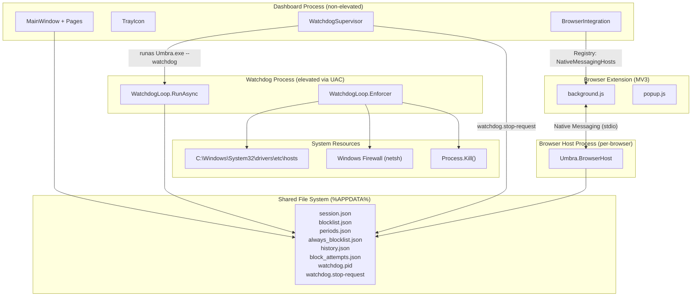

# GRITWALL Source Audit — Umbra Upstream Codebase

**Audit date:** 2026-11-05  
**Upstream:** [zixload/umbra](https://github.com/zixload/umbra)  
**Branch:** `gritwall/source-audit`  
**Commit:** `5978b0d` — Fix culture-dependent period tests  
**Test result:** 129/129 passed, 0 warnings, 0 errors  
**Git status:** Clean working tree

---

## 1. Repository Structure

### 1.1 Solution Layout (`Umbra.slnx`)

| Project | Type | Target | Purpose |
|---|---|---|---|
| `Umbra.App` | WinExe (WPF) | `net10.0-windows10.0.19041.0` | Desktop GUI — tray icon, pages, floating timer |
| `Umbra.Core` | Library | `net10.0-windows10.0.19041.0` | Sessions, schedules, blocking, statistics, settings, updater |
| `Umbra.BrowserHost` | Console Exe | `net10.0-windows10.0.19041.0` | Native-messaging bridge for the browser extension |
| `Umbra.Tests` | xUnit | `net10.0-windows10.0.19041.0` | Core regression tests (129 tests) |

### 1.2 Supporting Directories

| Path | Purpose |
|---|---|
| `Umbra.App/browser-extension/` | Manifest V3 Chrome extension (Umbra Blocker) |
| `Umbra.App/Assets/` | Ambient sounds, backgrounds, brand assets, notification sounds |
| `Umbra.App/Pages/` | WPF page code-behind: Blocklist, Focus, Periods, Settings, Sounds, Stats |
| `installer/` | Inno Setup script (`Umbra.iss`) |
| `scripts/` | PowerShell build-release script |
| `store-assets/` | Chrome Web Store listing graphics |
| `docs/screenshots/` | README screenshots |
| `.github/workflows/` | CI (`ci.yml`) and release (`release.yml`) workflows |

### 1.3 NuGet Dependencies

| Package | Version | Project | Purpose |
|---|---|---|---|
| `WPF-UI` | 4.3.0 | Umbra.App | WPF UI controls and theming |
| `Microsoft.Toolkit.Uwp.Notifications` | 7.1.3 | Umbra.App | Toast notifications without MSIX |
| `NAudio.Wasapi` | 2.2.1 | Umbra.Core | Spotify per-app volume control (WASAPI) |
| `xunit` | 2.9.3 | Umbra.Tests | Test framework |
| `xunit.runner.visualstudio` | 3.1.4 | Umbra.Tests | VS test runner adapter |
| `coverlet.collector` | 6.0.4 | Umbra.Tests | Code coverage collection |
| `Microsoft.NET.Test.Sdk` | 17.14.1 | Umbra.Tests | Test SDK |

### 1.4 Data Storage

All persistent data is stored in `%APPDATA%\UmbraNative\data\`:

| File | Content |
|---|---|
| `session.json` | Current focus session state |
| `history.json` | Focus session history (max 2000 entries) |
| `periods.json` | Recurring/one-time schedule definitions |
| `blocklist.json` | Active session blocklist (apps + sites) |
| `always_blocklist.json` | Permanent blocklist (independent of sessions) |
| `saved_blocklists.json` | Named blocklist profiles |
| `session_tasks.json` | Session task (quest) definitions |
| `music_history.json` | Music playback statistics (with thumbnails) |
| `block_attempts.json` | Blocked attempt counters (max 500 entries) |
| `settings.json` | Application preferences |
| `watchdog.pid` | Watchdog heartbeat (PID, rewritten every 2s) |
| `watchdog.log` | Watchdog diagnostic log |
| `watchdog.stop-request` | Cooperative shutdown signal for watchdog |
| `watchdog.stopped` | Confirmation of watchdog shutdown |
| `browser-host.stop-request` | Cooperative shutdown signal for browser host |
| `browser-native-host.json` | Native messaging host manifest |
| `hosts.backup` | Backup of original hosts file |
| `pending-update-version.txt` | Expected version after silent update |
| `logs/` | Crash reports (max 20 files) |
| `updates/` | Downloaded installer files (cleaned up) |

**Format:** All data files use JSON with `System.Text.Json`. Writes use `AtomicFile.WriteAllText()` (write-to-temp-then-rename pattern).

---

## 2. Application Architecture

### 2.1 Entry Point (`App.xaml.cs`)

The application has **two operating modes**, selected by command-line argument:

1. **Dashboard mode** (default): Creates `MainWindow`, tray icon, single-instance coordinator, starts reminder timer, checks for updates.
2. **Watchdog mode** (`--watchdog`): Headless, no UI. Runs the `WatchdogLoop` enforcement cycle. Launched as an elevated (admin) process via UAC.

Both modes run in the same `Umbra.exe` executable.

```
ShutdownMode = OnExplicitShutdown  (App.xaml)
```

This keeps both modes alive without a visible window.

### 2.2 Component Communication



### 2.3 Inter-Process Communication

All IPC is **file-based** via the shared `%APPDATA%\UmbraNative\data\` directory:

- **Session state:** `session.json` is read/written by dashboard, watchdog, and browser host
- **Watchdog heartbeat:** `watchdog.pid` is rewritten every 2s; checked via file modification time
- **Cooperative shutdown:** `watchdog.stop-request` / `watchdog.stopped` signal files
- **Browser host shutdown:** `browser-host.stop-request` signal file
- **History mutex:** Named `Mutex` (`UmbraNative_HistoryFileMutex`) synchronizes `history.json` across processes
- **Music history mutex:** Named `Mutex` (`Local\UmbraNative.MusicHistory`) synchronizes `music_history.json`
- **Single instance:** `SingleInstanceCoordinator` uses a named `EventWaitHandle` (`UmbraNative.Desktop`)

### 2.4 Dependency Injection

**There is no DI container.** The codebase uses static classes throughout (`Session`, `Blocker`, `Blocklist`, `History`, `Periods`, `Settings`, etc.). Configuration paths are centralized in the static `Config` class. Test isolation is achieved by redirecting `Config.DataDir` to temporary directories.

---

## 3. Application Blocking

### 3.1 How Applications Are Identified

- `RunningApps.GetVisibleAppNames()` enumerates processes with visible main windows, filtering protected system processes via `Config.ProtectedProcesses`
- Applications are identified by **executable name only** (e.g., `Discord.exe`), not by path or window title
- Matching is **case-insensitive** (`StringComparer.OrdinalIgnoreCase`)

**Source:** [`RunningApps.cs`](file:///D:/Projects/Gritwall/Umbra.Core/RunningApps.cs#L10-L35), [`Blocker.cs`](file:///D:/Projects/Gritwall/Umbra.Core/Blocker.cs#L120-L140)

### 3.2 How Applications Are Blocked

`Blocker.EnforceAppBlock()` is the sole enforcement method:

1. Receives a list of blocked app names
2. Strips `.exe` suffix for `Process.GetProcessesByName()`
3. Calls `proc.Kill()` on every matching process
4. Returns the list of successfully killed apps
5. Killed apps are recorded in `BlockAttemptHistory`

**Critical detail:** There is **no relaunch prevention**. The watchdog loop re-checks every 2 seconds and kills again if the app reappears.

**Source:** [`Blocker.cs`](file:///D:/Projects/Gritwall/Umbra.Core/Blocker.cs#L142-L177)

### 3.3 Protected Processes

The following are never killed (`Config.ProtectedProcesses`):
`system`, `csrss.exe`, `winlogon.exe`, `services.exe`, `lsass.exe`, `svchost.exe`, `dwm.exe`, `explorer.exe`, `umbra.exe`, `umbranative.exe`, `dotnet.exe`, plus several others.

**Source:** [`Config.cs`](file:///D:/Projects/Gritwall/Umbra.Core/Config.cs#L77-L84)

### 3.4 Limitations

1. **Process name only** — no path matching. A renamed executable bypasses blocking.
2. **No UWP/Store app awareness** — UWP apps have process names that may differ from their display names.
3. **Kill can fail silently** — `proc.Kill()` is wrapped in try/catch; insufficient privileges are swallowed.
4. **No relaunch prevention** — apps can be relaunched between 2-second polling intervals.
5. **2-second window** — a blocked app runs for up to 2 seconds before the next poll kills it.

---

## 4. Website Blocking

### 4.1 Enforcement Layers

Website blocking uses a **three-layer approach**:

#### Layer 1: Hosts File (`Blocker.ApplySiteBlock()`)
- Writes `127.0.0.1 domain` + `127.0.0.1 www.domain` entries between `# --- UMBRANATIVE BLOCK START ---` / `# --- UMBRANATIVE BLOCK END ---` markers
- Requires **administrator privileges** (watchdog runs elevated)
- Backs up original hosts file to `hosts.backup`
- Handles truncated/orphaned blocks from previous crashes

**Source:** [`Blocker.cs`](file:///D:/Projects/Gritwall/Umbra.Core/Blocker.cs#L37-L72)

#### Layer 2: DoH Firewall Block (`Blocker.ApplyDohBlockAsync()`)
- Blocks outbound connections to Cloudflare (1.1.1.1, 1.0.0.1), Google DNS (8.8.8.8, 8.8.4.4), and Quad9 (9.9.9.9, 149.112.112.112) via `netsh advfirewall`
- Prevents Chromium browsers from bypassing hosts file via DNS-over-HTTPS
- **Best-effort** — failure is silently swallowed

**Source:** [`Blocker.cs`](file:///D:/Projects/Gritwall/Umbra.Core/Blocker.cs#L87-L115)

#### Layer 3: Browser Extension (`background.js`)
- Uses `chrome.declarativeNetRequest` to redirect matching domains to `blocked.html`
- Regex pattern: `^https?://([^/]+\.)?{domain}(?::[0-9]+)?(?:/|$)`
- Handles already-open tabs via `chrome.tabs.query()` + `chrome.tabs.update()`
- Restores blocked tabs when blocking ends

**Source:** [`background.js`](file:///D:/Projects/Gritwall/Umbra.App/browser-extension/background.js#L53-L116)

### 4.2 Native Messaging Protocol

The browser extension communicates with `Umbra.BrowserHost.exe` via Chrome's native messaging protocol:

- **Transport:** stdio (4-byte little-endian length prefix + JSON payload)
- **Host name:** `com.umbra.browser_blocker`
- **Allowed origins:** Store extension ID + manual extension ID
- **Poll interval:** 2 seconds (both host and extension)

**Messages:**
| Action | Direction | Purpose |
|---|---|---|
| `getState` | Extension → Host | Polls blocking state + session status |
| `recordAttempt` | Extension → Host | Records a blocked site visit |
| `stopSession` | Extension → Host | Stops current session (respects hard mode) |

**Source:** [`Program.cs`](file:///D:/Projects/Gritwall/Umbra.BrowserHost/Program.cs#L1-L93)

### 4.3 Browser Support

Registration via HKCU registry keys at install time and on each app launch:

| Browser | Registry Path |
|---|---|
| Chrome | `Software\Google\Chrome\NativeMessagingHosts` |
| Vivaldi | `Software\Vivaldi\NativeMessagingHosts` |
| Edge | `Software\Microsoft\Edge\NativeMessagingHosts` |
| Brave | `Software\BraveSoftware\Brave-Browser\NativeMessagingHosts` |

**Firefox is not supported** — it uses a different native messaging API.

**Source:** [`BrowserIntegration.cs`](file:///D:/Projects/Gritwall/Umbra.App/BrowserIntegration.cs#L16-L22), [`Umbra.iss`](file:///D:/Projects/Gritwall/installer/Umbra.iss#L54-L58)

### 4.4 Private/Incognito Windows

The extension manifest does **not** request `"incognito": "split"` or `"incognito": "spanning"`. By default, Chrome extensions **are disabled in incognito** unless the user explicitly grants access in `chrome://extensions`. The hosts file and DoH firewall rules still apply in incognito.

### 4.5 What Happens When the Extension Is Disabled

- **Hosts file blocking still applies** — domains resolve to 127.0.0.1
- **DoH firewall still applies** — prevents secure DNS bypass
- **No extension redirect** — the user sees a browser connection error instead of the friendly `blocked.html` page
- **No blocked-attempt recording** — the counter stops incrementing

### 4.6 Limitations

1. **Only Chromium browsers** — Firefox, Safari, and non-browser apps are not covered by the extension
2. **Extension can be disabled** — user can toggle it off in browser settings (hosts file still blocks)
3. **No URL path/pattern matching** — only domain-level blocking
4. **DoH list is static** — only 6 resolvers are blocked; custom DoH/DoT servers bypass it
5. **Subdomain handling** — `www.` is stripped; other subdomains match via regex
6. **No HTTPS certificate pinning** — the blocked page is a redirect, not an interception

---

## 5. Hard Mode and Security

### 5.1 How Hard Mode Works

Hard mode is a flag on **sessions** (`SessionState.HardMode`) and **periods** (`Period.HardMode`).

When active:
- `Session.CanStop()` returns `false` while `RemainingSeconds > 0`
- The tray menu shows "🔒 Stop" instead of an active stop button
- `BrowserSessionControl.TryStop()` returns `error: "hardMode"`
- The browser extension popup disables the Stop button

**Source:** [`Session.cs`](file:///D:/Projects/Gritwall/Umbra.Core/Session.cs#L156-L161)

### 5.2 Watchdog Loop

`WatchdogLoop.RunAsync()` runs in the elevated process:

- **Poll interval:** 2000ms (`PollMs`)
- **Heartbeat:** Rewrites `watchdog.pid` with current PID every tick
- **Cooperative shutdown:** Checks for `watchdog.stop-request` file each tick

Each tick:
1. Loads `session.json` (advancing pomodoro phases if due)
2. Loads `periods.json` and finds active periods
3. Resolves hard-locked periods (tamper detection)
4. Loads `always_blocklist.json`
5. If blocking needed: applies hosts + DoH firewall + kills apps
6. If not blocking: cleans up hosts + firewall (every tick, to catch orphaned blocks)
7. Handles session expiry for custom sessions
8. Detects phase transitions and notifies (done/break/work)
9. Tracks period history for statistics

**Source:** [`WatchdogLoop.cs`](file:///D:/Projects/Gritwall/Umbra.Core/WatchdogLoop.cs#L123-L260)

### 5.3 Trusted Hard Periods (Tamper Detection)

When a period with `HardMode=true` is active, the watchdog snapshots its blocklists and end time into `_trustedHardPeriods`. If the period is subsequently disabled, deleted, or its end time is moved earlier in `periods.json`, the watchdog continues enforcing the **original** blocklists until the **original** end time.

**Critical caveat:** This state is **in-memory only**. Restarting the watchdog process resets all trusted period locks.

**Source:** [`WatchdogLoop.cs`](file:///D:/Projects/Gritwall/Umbra.Core/WatchdogLoop.cs#L262-L295)

### 5.4 Security Boundaries

#### What Hard Mode Actually Protects

1. Prevents stopping a session via the UI stop button
2. Prevents stopping a session via the browser extension popup
3. Prevents disabling a hard-mode period while it's active (UI-enforced)
4. Continues blocking even if `periods.json` is edited (in-memory trust)

#### What Hard Mode Does NOT Protect

| Bypass Vector | Difficulty | Explanation |
|---|---|---|
| Task Manager → kill elevated Umbra.exe | Easy (admin) | The watchdog runs as a regular elevated process, not a service |
| Edit `session.json` → set `active: false` | Easy (any user) | File is in `%APPDATA%`, writable by the current user |
| Edit `periods.json` → then restart watchdog | Easy (any user) | In-memory trust resets on process restart |
| Disable browser extension | Easy (any user) | Chrome settings, no admin needed |
| Delete `watchdog.pid` + `watchdog.stop-request` | Easy (any user) | Dashboard checks heartbeat, may not restart |
| Use Firefox/Safari | Easy (any user) | No extension support; hosts file still applies |
| Use a custom DoH/DoT server | Moderate | Only 6 static IPs are blocked |
| Use a VPN/proxy | Moderate | Hosts file only applies locally |
| Change system clock | Easy (any user) | Period end times use wall clock |
| Run blocked app from a different `.exe` name | Easy (any user) | Only process name matching |

#### Can the Watchdog Be Terminated?

- **Standard user:** No — the watchdog runs elevated. `Process.Kill()` from a non-elevated process will fail with `Access Denied`.
- **Administrator / Task Manager as admin:** Yes — it is a regular process, not a protected Windows service.
- **After restart:** The dashboard calls `WatchdogSupervisor.Ensure()` to restart it, but only when a session/period is active.

### 5.5 Application Shutdown Behaviour

- Closing the main window **hides to tray** (does not quit)
- "Quitter" in tray menu calls `QuitReally()` — stops reminder timer, disposes tray icon, shuts down
- The **watchdog is NOT stopped** when the dashboard quits — it continues running independently
- Update process: stops watchdog cooperatively → installs → relaunches

### 5.6 Uninstallation

- Installer uses `PrivilegesRequired=lowest` — no admin needed to uninstall
- `PrepareToInstall` attempts to stop watchdog via signal files, then `taskkill /F`
- `CurUninstallStepChanged` uses `taskkill /IM Umbra.exe /F` and removes the Run registry key
- **Data directory is preserved** — `%APPDATA%\UmbraNative\data` survives uninstall

---

## 6. Statistics and Tracking

### 6.1 What Is Actually Tracked

| Feature | Status | Details |
|---|---|---|
| Focus session duration | ✅ Fully implemented | `History.Append()` records `FocusedMinutes` per session |
| Passive foreground app tracking | ❌ Not implemented | No continuous process monitoring for usage time |
| Individual app usage duration | ❌ Not implemented | Only records which apps were killed (block attempts) |
| Individual website usage duration | ❌ Not implemented | No per-site time tracking |
| Website domain history | ⚠️ Partial | `BlockAttemptHistory` counts blocked visits, not browsing |
| Idle detection | ❌ Not implemented | No user-idle API integration |
| Active vs idle time | ❌ Not implemented | No distinction |
| Hourly activity timeline | ✅ Fully implemented | `StatsRange.HoursIn()` — 24 buckets based on session end time |
| Daily statistics | ✅ Fully implemented | `StatsRange.DaysIn()` + `Summarize()` |
| Weekly statistics | ✅ Fully implemented | `StatsRange.Summarize()` with `StatsGranularity.Week` |
| Monthly statistics | ✅ Fully implemented | `StatsRange.Summarize()` with `StatsGranularity.Month` |
| Historical reports / navigation | ✅ Fully implemented | `StatsPeriod.Previous()` with day/week/month granularity |
| CSV/JSON export | ❌ Not implemented | No export functionality |
| Streak tracking | ✅ Fully implemented | Current streak + best streak in `History.GetStats()` |
| Quest/task breakdown | ✅ Fully implemented | `StatsRange.QuestsIn()` groups by `QuestName` |
| Session type breakdown | ✅ Fully implemented | `StatsRange.KindsIn()` groups by kind (custom/pomodoro/schedule) |
| Time-of-day breakdown | ✅ Fully implemented | `StatsRange.TimeOfDayIn()` — morning/afternoon/evening/night |
| Music playback stats | ✅ Fully implemented | `MusicHistory` tracks per-track play time and count |
| Block attempt counts | ✅ Fully implemented | `BlockAttemptHistory` — per-target counts, max 500 |

### 6.2 History Data Model

```json
{
  "endedAt": 1730000000000,
  "kind": "custom",
  "hardMode": false,
  "questName": "Thesis",
  "focusedMinutes": 25.0
}
```

- `endedAt`: Unix timestamp in milliseconds (UTC)
- `kind`: `"custom"` | `"pomodoro"` | `"schedule"`
- Maximum 2000 entries retained

**Source:** [`History.cs`](file:///D:/Projects/Gritwall/Umbra.Core/History.cs#L7-L23)

---

## 7. Scheduling and Allowances

### 7.1 Focus Sessions

| Feature | Status | Details |
|---|---|---|
| Free timer (custom) | ✅ Implemented | `Session.StartCustom()` — arbitrary duration |
| Pomodoro | ✅ Implemented | `Session.StartPomodoro()` — configurable work/break/cycles |
| Hard mode toggle | ✅ Implemented | Prevents stopping before timer expires |
| Quest/task naming | ✅ Implemented | Free-text name stored in history |

### 7.2 Recurring Schedules (Periods)

| Feature | Status | Details |
|---|---|---|
| Recurring by day-of-week | ✅ Implemented | `Period.Days` — Sunday=0 through Saturday=6 |
| One-time (date-specific) | ✅ Implemented | `Period.Recurring=false`, `Period.Date` |
| Cross-midnight periods | ✅ Implemented | `PeriodCoversNow` handles wrap-around |
| Per-period blocklists | ✅ Implemented | Each period has its own `Apps` and `Sites` |
| Period-level hard mode | ✅ Implemented | `Period.HardMode` + trusted lock |
| Period-level pomodoro | ✅ Implemented | `Period.PomodoroMode` — 25/5 cycles within period window |
| Pause for today | ✅ Implemented | `Period.PausedDate` — skips one day without config change |
| Auto-cleanup of past one-off periods | ✅ Implemented | Removed in `Periods.Load()` |

### 7.3 Missing Scheduling Features

| Feature | Status |
|---|---|
| Per-application daily/weekly time limits | ❌ Not implemented |
| Per-website daily/weekly time limits | ❌ Not implemented |
| Daily/weekly allowances | ❌ Not implemented |
| Category-based time budgets | ❌ Not implemented |
| Grace periods | ❌ Not implemented |
| Emergency overrides | ❌ Not implemented (intentionally — contradicts hard mode) |
| Time-zone aware scheduling | ⚠️ Uses `DateTime.Now` (system local time) |
| Midnight boundary handling | ✅ Implemented in `PeriodCoversNow` |

---

## 8. Code Quality and Testing

### 8.1 Test Coverage

**129 tests across 18 test files:**

| Test File | Tests | Covers |
|---|---|---|
| `BlockerTests.cs` | ≥5 | Hosts file manipulation, app blocking |
| `BlocklistTests.cs` | ≥8 | Normalization, migration, round-trip persistence |
| `AlwaysBlocklistTests.cs` | ≥2 | Permanent blocklist load/save |
| `BrowserBlockingStateTests.cs` | ≥3 | Combined blocking state resolution |
| `BrowserHostLifecycleTests.cs` | ≥2 | Stop request signaling |
| `BrowserSessionControlTests.cs` | 3 | Session stop with hard mode |
| `BlockAttemptHistoryTests.cs` | ≥1 | Aggregation and sorting |
| `HistoryTests.cs` | ≥5 | Stats, streaks, breakdowns |
| `MusicHistoryTests.cs` | ≥2 | Playback recording and retrieval |
| `PeriodsTests.cs` | ≥18 | Period coverage, timing, pomodoro, edge cases |
| `SessionTests.cs` | ≥5 | Session lifecycle, pomodoro advancement |
| `SettingsTests.cs` | ≥2 | Settings load/save |
| `SingleInstanceCoordinatorTests.cs` | 2 | Single-instance enforcement |
| `StatsRangeTests.cs` | ≥10 | Period navigation, summaries, breakdowns |
| `CrashReporterTests.cs` | 2 | Report creation and pruning |
| `UpdateReadinessTests.cs` | ≥3 | Update blocking during sessions |
| `UpdaterTests.cs` | ≥4 | Version comparison, URL validation, SHA-256 |
| `VocabTests.cs` | ≥2 | Vocabulary system (legacy) |

### 8.2 Code Quality Observations

| Area | Assessment |
|---|---|
| **Nullable annotations** | ✅ Enabled project-wide (`<Nullable>enable</Nullable>`) |
| **Error handling** | ✅ Defensive — all `catch` blocks prevent crashes at cost of silent failures |
| **Atomic writes** | ✅ `AtomicFile` uses write-to-temp-then-rename pattern |
| **Cross-process safety** | ✅ Named mutexes for `History` and `MusicHistory` |
| **Thread safety** | ⚠️ Static mutable state in several classes (`Config.DataDir`, `MusicHistory._cachedData`) |
| **Async operations** | ✅ Proper `async/await` throughout; `Task.Delay` in watchdog loop |
| **Resource disposal** | ✅ `Process.Dispose()` in `finally` blocks; `using` for streams |
| **Logging** | ⚠️ Minimal — watchdog log only; no structured logging framework |
| **Localization** | ✅ French/English via `Loc.cs`; culture-invariant parsing |
| **Comments** | ✅ Extensive French comments explaining design decisions |

### 8.3 Potential Issues

1. **`Config` static state** — `DataDir` and `HostsPath` are mutable statics. Thread-safe for tests but risky if ever parallelized.
2. **JSON deserialization resilience** — all `Load()` methods return empty defaults on any exception. Data loss from corrupted files is silent.
3. **`BlockAttemptHistory.Record()`** — no mutex; concurrent calls from watchdog and browser host could lose records (mitigated by `AtomicFile` but still a TOCTOU race).
4. **Firewall rule management** — `netsh` is fire-and-forget; no verification that the rule was actually created.
5. **2000-entry history cap** — no user warning when old entries are trimmed.

---

## 9. Security and Privacy

### 9.1 Data Collection

| What | Where | Leaves Device? |
|---|---|---|
| Focus session history | `%APPDATA%\UmbraNative\data\history.json` | No |
| Blocked site/app counts | `%APPDATA%\UmbraNative\data\block_attempts.json` | No |
| Music playback stats | `%APPDATA%\UmbraNative\data\music_history.json` | No |
| Settings/preferences | `%APPDATA%\UmbraNative\data\settings.json` | No |
| Crash reports | `%APPDATA%\UmbraNative\data\logs\` | No |
| Browsing history | Never collected | — |

### 9.2 Network Access

| Purpose | Endpoint | When |
|---|---|---|
| Update check | `api.github.com/repos/zixload/umbra/releases/latest` | 6 seconds after startup + manual |
| Installer download | `github.com` / `*.githubusercontent.com` | User-initiated update |
| Extension store | `chromewebstore.google.com` | User clicks "Install extension" |

**No telemetry, analytics, or tracking services are contacted.**

### 9.3 Privilege Usage

| Action | Privilege | Method |
|---|---|---|
| Write hosts file | Admin | Watchdog runs elevated (`Verb = "runas"`) |
| Create firewall rule | Admin | `netsh advfirewall` from elevated watchdog |
| Kill blocked processes | Admin | `Process.Kill()` from elevated watchdog |
| Registry write (HKCU) | User | Native messaging host registration |

### 9.4 Third-Party Dependencies Risk

| Dependency | Risk | Notes |
|---|---|---|
| WPF-UI | Low | Well-maintained UI library (MIT) |
| NAudio.Wasapi | Low | Audio API wrapper (MIT); only used for Spotify volume |
| Microsoft.Toolkit.Uwp.Notifications | Low | Microsoft-maintained toast notification helper |

### 9.5 Suspicious Patterns: None Identified

No obfuscated code, no hardcoded credentials, no undocumented network calls, no data exfiltration, no cryptocurrency mining. The codebase is straightforward and well-documented in French.

---

## 10. CI/CD and Build System

### 10.1 GitHub Actions

- **CI** (`ci.yml`): Builds and tests on push/PR
- **Release** (`release.yml`): Builds release artifacts, creates GitHub release with installer + extension + checksums

### 10.2 Installer

- **Inno Setup 6** with modern wizard style
- Installs to `{localappdata}\Programs\Umbra` (per-user, no admin required)
- Registers native messaging host for 4 browsers via HKCU registry
- Cooperative watchdog shutdown during updates (signal file + polling)
- Uninstall preserves data directory

### 10.3 Build Script

`scripts/build-release.ps1` produces:
- Self-contained Windows x64 installer
- Browser extension ZIP packages (store + manual)
- `SHA256SUMS.txt`

