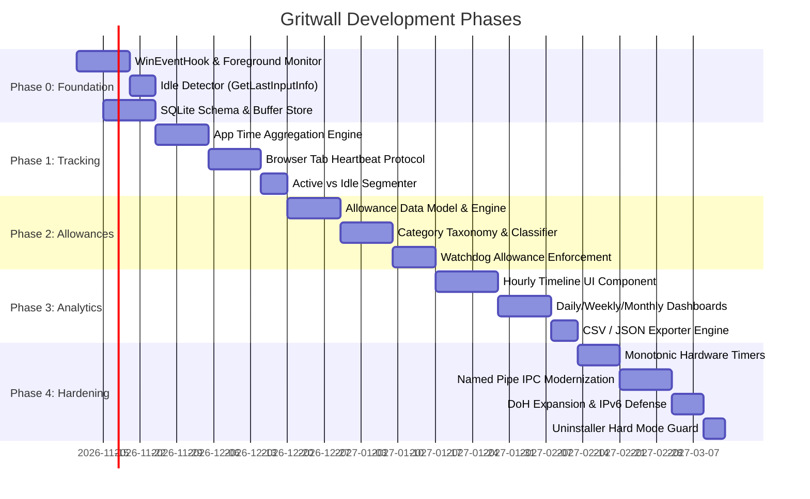

# GRITWALL — Technical Roadmap

**Document Version:** 1.0.0
**Target Platform:** Windows 11 (x64)
**Base Architecture:** Umbra (.NET 10, WPF, C# 14)
**Status:** Audit & Planning Phase — Architectural Blueprint

---

## 1. Executive Strategy

GRITWALL transforms the single-purpose focus timer and blocking utility into a complete, privacy-respecting, local-first digital wellbeing and distraction management platform.

### Core Architectural Principles
1. **Local-First & Zero-Telemetry:** All activity tracking, website domain records, statistics, and configurations remain strictly on the user's physical machine. No network analytics, cloud accounts, or remote telemetry are permitted.
2. **Deterministic Enforcement:** Eliminate reactive race windows and client bypass backdoors. Move from an unauthenticated file-based IPC to authenticated inter-process communication with monotonic time tracking.
3. **Low Overhead & High Fidelity:** Passive tracking must consume negligible CPU (<0.5% average) and memory (<50MB for background monitoring) while maintaining sub-second accuracy for active application and website state transitions.
4. **Graceful Evolution:** Retain and build upon the robust WPF UI (`Wpf.Ui`), sound synthesis engine (`NAudio.Wasapi`), atomic file operations (`AtomicFile`), and existing period scheduling engine (`Periods.cs`), while isolating high-frequency tracking data into a dedicated persistence layer.

---

## 2. Capability Gap Matrix & Phase Mapping

| Capability Area | Existing Codebase State | Target GRITWALL State | Delivery Phase |
| :--- | :--- | :--- | :--- |
| **Foreground Tracking** | None (`RunningApps.cs` inspects running executables without focus detection) | Windows Event Hook (`SetWinEventHook`) capturing foreground transitions and full image paths | **Phase 0** |
| **Idle Detection** | None | System idle tracking via `GetLastInputInfo` (5-minute configurable threshold) | **Phase 0** |
| **Activity Persistence** | Flat JSON files (`history.json`, `session.json`) suitable only for low-frequency session records | Embedded SQLite engine (`Microsoft.Data.Sqlite`) for high-frequency window and domain intervals | **Phase 0** |
| **Application Tracking** | None (only process name termination in `Blocker.cs`) | Per-application active time, launch count, and timeline recording with path resolution | **Phase 1** |
| **Website Tracking** | Binary block redirect in extension (`declarativeNetRequest`) | Active tab domain and duration reporting via Native Messaging protocol (`Umbra.BrowserHost`) | **Phase 1** |
| **Daily Allowances** | None | Configurable per-app and per-site daily time budgets with countdown warnings | **Phase 2** |
| **Category Budgets** | None (only static blocklists: `Default`, `Social`, `Games`) | Dynamic application and domain categorization engine (Social, Gaming, Adult, Productive) | **Phase 2** |
| **Adult Content Filtering** | Static domain entries in `BlocklistPresets.cs` | Comprehensive local domain taxonomy, CleanBrowsing/Family DoH enforcement, safe search enforcement | **Phase 2** |
| **Analytics & Timelines** | Aggregated focus session charts in `StatsPage.xaml.cs` | 24-hour hourly activity heatmaps, daily/weekly/monthly breakdown charts, and timeline scrubbers | **Phase 3** |
| **Data Export** | None | CSV and JSON raw export capabilities for user sovereignty | **Phase 3** |
| **Hard Mode & Integrity** | Signal file backdoor, wall-clock reliance, unauthenticated JSON | Monotonic hardware timers, ACL-protected Named Pipes, Windows Service / tamper-resistant watchdog | **Phase 4** |

---

## 3. Phased Implementation Roadmap

```
+-------------------------------------------------------------------------------------------------+
|                                    GRITWALL TECHNICAL ROADMAP                                   |
+-------------------------------------------------------------------------------------------------+
|  Phase 0: Foundation Engine            |  Phase 1: Granular Tracking Engine                     |
|  - Win32 Event Hooks & Idle Monitor     |  - Per-Application Active Time Aggregator              |
|  - SQLite Local Activity Store          |  - Browser Extension Tab Heartbeat                     |
|  - IPC Contract Modernization           |  - Active vs. Idle Timeline Segmenter                  |
+-----------------------------------------+-------------------------------------------------------+
                    |                                                 |
                    v                                                 v
+-----------------------------------------+-------------------------------------------------------+
|  Phase 2: Allowances & Categorization   |  Phase 3: Analytics, Timelines & Export                |
|  - Per-App & Per-Domain Daily Budgets   |  - 24-Hour Hourly Timeline Visualizer                 |
|  - Category Taxonomies & Rules Engine   |  - Daily / Weekly / Monthly Aggregation Dashboards    |
|  - Budget Enforcement in Watchdog       |  - CSV & JSON Data Exporters                          |
+-----------------------------------------+-------------------------------------------------------+
                    |                                                 |
                    v                                                 v
+-------------------------------------------------------------------------------------------------+
|  Phase 4: Security Hardening & Tamper Resistance                                                |
|  - Hardware Monotonic Timers (Stopwatch / TickCount64)                                          |
|  - Named Pipe IPC with Integrity Check & Signal File Deprecation                               |
|  - Dual-Stack IPv4/IPv6 DoH Filtering & Firefox Native Host Support                            |
|  - Uninstaller Hard Mode Guard                                                                  |
+-------------------------------------------------------------------------------------------------+
```

---

### Phase 0: Foundation & Storage Architecture
**Objective:** Establish non-intrusive, low-overhead OS hook infrastructure and high-frequency persistence without disturbing existing focus session mechanics.

#### Work Packages
- **WP 0.1: Windows Event Hook Tracking Engine (`Gritwall.Core.Tracking.WinEventHookTracker`)**
  - Implement unmanaged hook via `SetWinEventHook` listening for `EVENT_SYSTEM_FOREGROUND` and `EVENT_OBJECT_NAMECHANGE`.
  - Resolve active window handle (`HWND`) to:
    - Process ID (`GetWindowThreadProcessId`).
    - Normalized process name (`Process.ProcessName`).
    - Full executable disk path (`QueryFullProcessImageName` with `PROCESS_QUERY_LIMITED_INFORMATION`).
    - Window title bar caption (`GetWindowText`).
  - Fallback to polling loop (1000ms cadence) if hook installation fails or drops.
  - References: `Umbra.Core/RunningApps.cs` (extend beyond process enumeration).

- **WP 0.2: System Idle State Monitor (`Gritwall.Core.Tracking.IdleDetector`)**
  - P/Invoke `GetLastInputInfo` from `user32.dll`.
  - Calculate idle milliseconds: `Environment.TickCount - lastInputInfo.dwTime`.
  - Introduce configurable idle threshold (default: 300 seconds / 5 minutes).
  - Fire `StateChanged(UserActivityState.Active | UserActivityState.Idle)` events.

- **WP 0.3: SQLite Activity Store & Crash-Resilient Persistence (`Gritwall.Core.Storage.ActivityDatabase`)**
  - Integrate `Microsoft.Data.Sqlite` (single-file embedded database at `%APPDATA%\Gritwall\data\activity.db`).
  - Implement schema with WAL (Write-Ahead Logging) mode and connection pooling:
    ```sql
    CREATE TABLE IF NOT EXISTS AppIntervals (
        Id INTEGER PRIMARY KEY AUTOINCREMENT,
        ProcessName TEXT NOT NULL,
        ExecutablePath TEXT NOT NULL,
        WindowTitle TEXT,
        StartTimeUtc TEXT NOT NULL,
        EndTimeUtc TEXT NOT NULL,
        DurationSeconds REAL NOT NULL,
        IsIdle INTEGER NOT NULL DEFAULT 0
    );
    CREATE INDEX IF NOT EXISTS idx_AppIntervals_Start ON AppIntervals(StartTimeUtc);
    CREATE INDEX IF NOT EXISTS idx_AppIntervals_Proc ON AppIntervals(ProcessName);

    CREATE TABLE IF NOT EXISTS WebIntervals (
        Id INTEGER PRIMARY KEY AUTOINCREMENT,
        BrowserProcess TEXT NOT NULL,
        Hostname TEXT NOT NULL,
        StartTimeUtc TEXT NOT NULL,
        EndTimeUtc TEXT NOT NULL,
        DurationSeconds REAL NOT NULL
    );
    CREATE INDEX IF NOT EXISTS idx_WebIntervals_Start ON WebIntervals(StartTimeUtc);
    CREATE INDEX IF NOT EXISTS idx_WebIntervals_Host ON WebIntervals(Hostname);
    ```
  - **Privacy Guarantee (Privacy-by-Design):** `UrlPath` and `Title` are strictly excluded from the persisted schema by default. Store only normalized hostnames (e.g., `github.com`, `reddit.com`) and minimal tracking metadata (`BrowserProcess`, `StartTimeUtc`, `EndTimeUtc`, `DurationSeconds`). Do not collect page titles or full URLs by default.
  - **Dual Checkpointing & Event-Driven Flush Strategy:**
    - *Periodic Checkpointing:* Enable WAL mode (`PRAGMA journal_mode=WAL; PRAGMA synchronous=NORMAL;`) with background checkpointing (`PRAGMA wal_checkpoint(PASSIVE)`) every 15 seconds during steady-state operation.
    - *Event-Driven Interval Flush:* In addition to periodic checkpointing, immediately commit and flush pending in-memory activity intervals to SQLite upon:
      1. **Application Transitions:** Every foreground window focus switch immediately commits the preceding window's active duration interval.
      2. **Idle Transitions:** When the user transitions between active and idle states (or returns from idle).
      3. **Session Lock / Workstation Lock:** Intercept `SessionSwitchReason.SessionLock` (`WM_WTSSESSION_CHANGE`) to immediately flush open intervals before sleep/lock.
      4. **Graceful Shutdown:** Intercept `App.OnExit`, OS shutdown/logoff, and watchdog stop requests to flush all committed buffers before process termination.
    - *Crash Recovery & Invariant Reconciliation:*
      - On database startup, execute `RecoverIncompleteIntervals()`: identify any unclosed intervals from an abrupt system crash or power outage, bounding them safely using the last confirmed heartbeat timestamp or system shutdown event to avoid corrupted or infinitely long interval records.

---

### Phase 1: Granular Tracking Engine
**Objective:** Achieve accurate, continuous per-application and per-website screen time recording.

#### Work Packages
- **WP 1.1: Application Time Aggregator**
  - Maintain in-memory tracking session: `CurrentForegroundApp`, `ActiveSinceUtc`, `LastHeartbeatUtc`.
  - On foreground switch: compute duration, split by midnight boundary if cross-day, commit interval to SQLite write buffer, reset for newly focused application.
  - On system suspend/resume (power events): automatically close open intervals to prevent false runtimes during sleep.

- **WP 1.2: Browser Extension Active Tab Tracking Protocol**
  - Extend `Umbra.BrowserHost/Program.cs` and `browser-extension/background.js`.
  - Capture active tab events in extension via `chrome.tabs.onActivated` and `chrome.webNavigation.onCommitted`.
  - Normalise URLs to hostnames in-memory (`new URL(tab.url).hostname`). Discard full paths, query strings, fragments, and page titles by default to respect privacy.
  - Emit minimal heartbeat message across native messaging pipe every 5 seconds:
    ```json
    { "type": "heartbeat", "hostname": "github.com", "incognito": false }
    ```
  - `BrowserHost` forwards heartbeats to local SQLite database or shared memory pipe.
  - References: `Umbra.App/browser-extension/background.js`, `Umbra.BrowserHost/Program.cs`.

- **WP 1.3: Active vs. Idle Segmentation Engine**
  - When idle threshold trips:
    - Mark active application interval as idle.
    - Stop accumulating "active usage" counters for allowances and metrics.
    - Keep "open duration" for total uptime reporting without penalizing productivity scores.

---

### Phase 2: Allowances, Budgets & Content Categorization
**Objective:** Empower users to set daily limits on apps and websites, categorize digital activities, and block harmful content.

#### Work Packages
- **WP 2.1: Allowance and Budget Data Model (`Gritwall.Core.Allowances`)**
  - Create `Allowances.cs` and `allowances.json`:
    - `TargetIdentifier` (executable bare name, full path, or domain).
    - `TargetType` (`Application` | `Website` | `Category`).
    - `DailyLimitMinutes` (e.g., 45 minutes).
    - `ResetTime` (e.g., "00:00").
    - `ActionOnExceeded` (`Block` | `Notify` | `HardLock`).
  - Calculate consumed daily budget by querying SQLite for current day:
    ```sql
    SELECT SUM(DurationSeconds) FROM AppIntervals
    WHERE ProcessName = @name AND StartTimeUtc >= @dayStart AND IsIdle = 0;
    ```

- **WP 2.2: Category Taxonomy & Local Classifier Engine**
  - Extend `BlocklistPresets.cs` into a dynamic categorizer:
    - **Social Media:** `discord.exe`, `telegram.exe`, `whatsapp.exe`, `twitter.com`, `instagram.com`, `reddit.com`.
    - **Gaming:** `steam.exe`, `epicgameslauncher.exe`, `riotclientservices.exe`, `roblox.exe`, `minecraft.exe`.
    - **Streaming / Video:** `netflix.com`, `youtube.com`, `twitch.tv`, `spotify.exe`.
    - **Adult Content:** Expanded offline blacklist of 50,000+ domain roots (compressed Trie or Bloom filter).
  - Allow user-defined category bindings and custom category budgets.

- **WP 2.3: Watchdog Allowance Enforcement Integration**
  - Extend `WatchdogLoop.TickAsync()`:
    - Evaluate active allowances against consumed seconds.
    - If allowance exceeded: inject target process into `blockedApps` list; inject target domain into `hosts` and extension blocklist.
    - Provide 5-minute and 1-minute warning desktop notifications via `AppNotifications.cs`.
  - References: `Umbra.Core/WatchdogLoop.cs`, `Umbra.Core/Blocker.cs`.

---

### Phase 3: Analytics, Timelines & Data Sovereignty
**Objective:** Deliver actionable, beautiful data visualizers in the WPF UI with full data export capabilities.

#### Work Packages
- **WP 3.1: 24-Hour Hourly Activity Timeline Visualizer**
  - Replace static session history charts in `StatsPage.xaml` with an interactive 24-hour timeline bar.
  - Color-code timeline blocks by category (Productive = Green, Social = Amber, Games = Purple, Unclassified = Grey).
  - Hover tooltip displaying application name, category, and active duration.

- **WP 3.2: Aggregated Views (Daily, Weekly, Monthly)**
  - Daily: Top 10 applications and websites bar chart, category breakdown donut chart, active vs. idle ratio.
  - Weekly / Monthly: Daily average screen time, peak usage hours heatmap (7x24 grid), trend comparison (+/- % vs previous period).
  - Extend `Umbra.Core/StatsRange.cs` to query SQLite aggregated summary views.

- **WP 3.3: Data Export Engine (`Gritwall.Core.Export`)**
  - JSON Exporter: Full hierarchical export of intervals, categories, and allowance records.
  - CSV Exporter: Flat table export for spreadsheet analysis:
    `Timestamp, Type (App/Web), Identifier, Category, ActiveDurationSeconds, IdleDurationSeconds`.
  - Ensure zero cloud dependencies during export generation.

---

### Phase 4: Security Hardening & Tamper Resistance
**Objective:** Eliminate structural backdoors, defend against wall-clock spoofing, and ensure restriction integrity.

#### Work Packages
- **WP 4.1: Monotonic Hardware Timer Architecture**
  - Replace all `DateTimeOffset.UtcNow` and `DateTime.Now` delta comparisons in `Session.cs` and `WatchdogLoop.cs` with `Environment.TickCount64` and `Stopwatch.GetTimestamp()`.
  - Store `AnchorTickCount64` alongside `AnchorUtc` at session/period start.
  - If wall-clock shifts forward by >60 seconds while monotonic tick delta is small, detect clock tampering, trigger alert, and preserve remaining time calculated from monotonic ticks.

- **WP 4.2: Authenticated Named Pipe IPC & Signal File Deprecation**
  - Deprecate `%APPDATA%\UmbraNative\data\watchdog.stop-request`.
  - Implement bidirectional Windows Named Pipe (`\\.\pipe\GritwallWatchdogPipe`) with security descriptor allowing read/write only to `BUILTIN\Administrators` and the current user token.
  - Require cryptographically random session authentication tokens generated by the elevated watchdog on startup and shared via protected memory or elevated pipe negotiation.

- **WP 4.3: Secure DNS & IPv6 Firewall Defense**
  - Expand `Config.DohBlockIps` to include IPv6 addresses for Cloudflare (`2606:4700:4700::1111`), Google (`2001:4860:4860::8888`), Quad9 (`2620:fe::fe`), and popular alternative providers (NextDNS, AdGuard, OpenDNS).
  - Configure Windows Firewall rule blocking outbound UDP/TCP port 853 (DNS-over-TLS).
  - References: `Umbra.Core/Blocker.cs`, `Umbra.Core/Config.cs`.

- **WP 4.4: Uninstaller Hard Mode Guard**
  - Update Inno Setup script (`installer/Umbra.iss` -> `installer/Gritwall.iss`).
  - Introduce Pascal script check in `InitializeUninstall()`:
    - Inspect `session.json` and `periods.json`.
    - If Hard Mode is currently active, abort uninstallation with a clear user notice explaining that active Hard Mode periods must expire before removal.
  - In `CurUninstallStepChanged(usPostUninstall)`, unconditionally execute hosts file and firewall rule cleanup before binary deletion.

---

## 4. Phase Delivery Timeline & Dependencies



---

## 5. Technical Risk Assessment & Mitigations

| Risk Description | Probability | Impact | Mitigation Strategy |
| :--- | :--- | :--- | :--- |
| **High SQLite I/O Overhead & Crash Safety:** Frequent writes from window switches and tab events impacting SSD health or risking data loss during abrupt power loss. | Medium | High | Combine periodic WAL checkpointing (every 15s) with deterministic event-driven flushing on window switches, idle transitions, workstation locks, and graceful shutdown. Run `RecoverIncompleteIntervals()` on startup for crash recovery. |
| **WinEventHook Thread Deadlocks:** UI thread contention or dropped unmanaged callbacks during high OS window turnover. | Low | High | Host the WinEventHook on a dedicated background STA thread with an unmanaged message pump, dispatching immutable events to the core aggregator via `Channel<T>`. |
| **Browser Extension Bypass via Private Browsing:** Users navigating in Incognito/InPrivate where extension is disabled. | High | Medium | Enforce policy or detect private browsing windows via window title heuristics, falling back to OS hosts file blocking for private sessions. |
| **Antivirus False Positive on Process Termination:** Aggressive antivirus heuristics flagging watchdog's `proc.Kill()` calls. | Medium | Medium | Sign all executables with an EV or trusted code signing certificate. Ensure `Umbra.exe / Gritwall.exe` binaries include detailed Assembly attributes and clean manifests. |
| **UAC Friction on Watchdog Startup:** Repeated UAC elevation prompts irritating users during normal operation. | High | Medium | Migrate elevated watchdog to a registered Windows Service (`Automatic` startup under `NT AUTHORITY\SYSTEM`), eliminating runtime UAC prompts completely after initial installation. |

---

## 6. Immediate Next Milestone: Milestone 0.1 Foundation Delivery

The recommended first development milestone focuses exclusively on delivering the non-invasive tracking foundation:
1. Retain the working .NET 10 solution and passing 129 tests.
2. Add `Microsoft.Data.Sqlite` to `Umbra.Core`.
3. Implement `WinEventHookTracker.cs` and `IdleDetector.cs` in `Umbra.Core`.
4. Implement `ActivityDatabase.cs` with schema migration and batching.
5. Create a prototype console/unit test verifying that window changes and idle states correctly persist to `activity.db` without crashing or dropping events.

